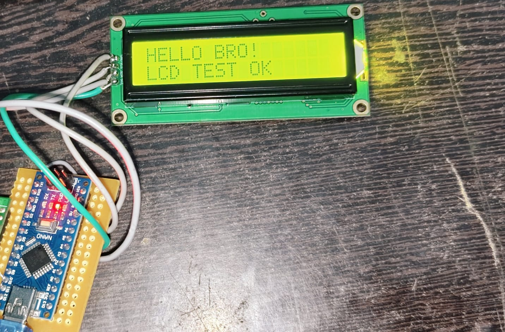

# Arduino Nano LCD Interface

## Project Overview
This project demonstrates interfacing an LCD (Liquid Crystal Display) with an Arduino Nano to display text and messages. The Arduino Nano processes the program instructions and sends data to the LCD, allowing information to be displayed on the screen.

This beginner-friendly embedded systems project provides practical experience in Arduino programming, LCD interfacing, and hardware-software integration.

---

## Objectives
- Interface an LCD display with an Arduino Nano.
- Display text and messages using Arduino programming.
- Understand basic microcontroller operations.
- Learn display interfacing and hardware connections.
- Develop practical embedded systems skills.

---

## Components Required
- Arduino Nano
- LCD display
- Jumper wires
- USB cable

---

## Circuit Diagram
The circuit diagram illustrates the hardware connections between the Arduino Nano and the LCD display.

---

## Working Principle
1. The Arduino Nano is programmed using the Arduino IDE.
2. The program initializes the LCD display.
3. The Arduino Nano sends commands and character data to the LCD.
4. The LCD displays the text specified in the program.
5. The displayed output depends on the instructions written in the code.

---

## Software Requirements
- Arduino IDE
- Appropriate LCD library, if required by the program
- USB connection for uploading the program

---

## Project Setup
1. Connect the LCD display to the Arduino Nano according to the circuit diagram.
2. Connect the Arduino Nano to the computer using a USB cable.
3. Open the project program in the Arduino IDE.
4. Select the appropriate Arduino Nano board and COM port.
5. Verify and upload the program.
6. Observe the displayed text on the LCD.

---

## Key Features
- Displays programmed text and messages.
- Demonstrates basic LCD interfacing.
- Uses the Arduino Nano as the control unit.
- Provides a foundation for microcontroller-based display applications.
- Suitable for beginners learning embedded systems.

---

## Applications
- Digital information display systems
- Sensor monitoring systems
- Temperature and humidity displays
- Embedded system prototypes
- Basic user-interface development
- Arduino-based automation projects

---

## Learning Outcomes
- Arduino Nano programming fundamentals
- LCD interfacing techniques
- Microcontroller communication with display modules
- Basic hardware-software integration
- Circuit connections and embedded system development

---

## Future Improvements
- Display real-time sensor readings.
- Add push buttons for user interaction.
- Develop a menu-based display system.
- Integrate additional sensors and modules.
- Expand the project into an IoT-based monitoring system.

---

## Conclusion
This project provides a practical introduction to interfacing an LCD display with an Arduino Nano. It builds fundamental embedded systems knowledge and serves as a starting point for more advanced microcontroller-based applications.

---

## 🏷️ Technologies Used
`Arduino Nano` `LCD Display` `Arduino IDE` `Embedded Systems` `C/C++` `Hardware Interfacing`
